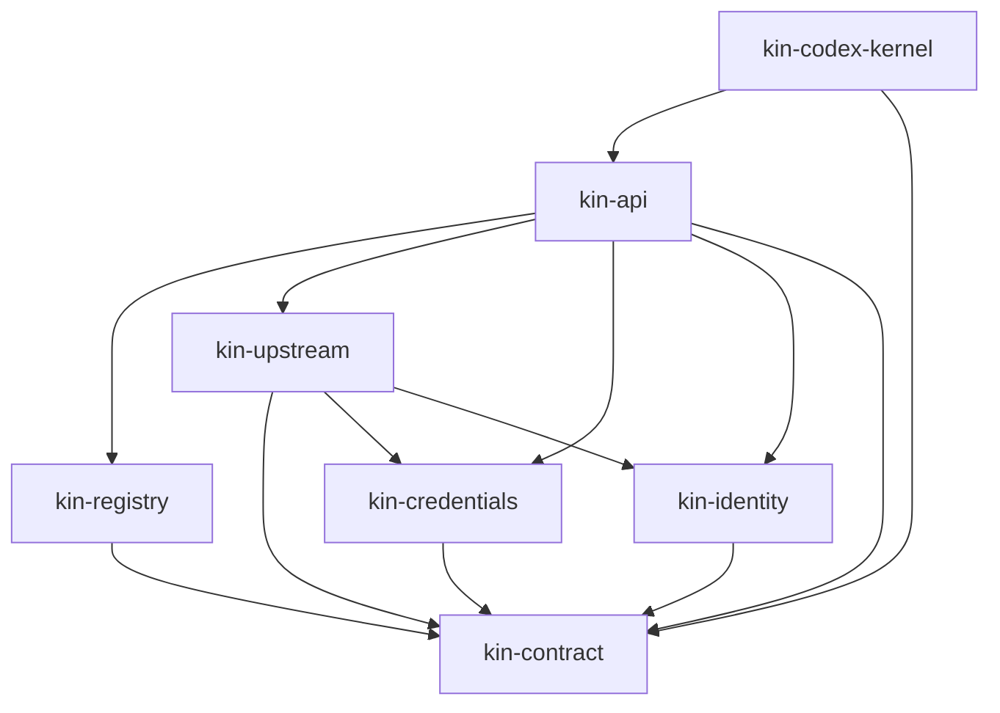

# kin-codex-kernel 架構

本文說明程式結構、相依規則與工程準則。功能需求與對控制面的契約，以 vm2api 的
`docs/CODEX_SHARED_KERNEL_DESIGN.md` 為準（第 4 節契約、第 4.6 節完整性清單、第 4.7 節相容模式、第 5 節核心設計）。

## 1. 定位與邊界

- **只做一件事：** 以每個帳號自己的身分、憑據與出口，把請求送到 ChatGPT 後端，並把結果與用量照契約回給控制面。
- **不做的事：** 選號、准入、計價、結算、重試策略都屬於 vm2api 控制面。核心只回報事實（含明確的送出狀態），不替控制面做決定。
- **兩種模式，同一份程式碼：**
  - **單帳號相容模式（ABI 1）：** 與上游 `kin-codex-kernel` 相同的設定格式與端點，可以逐槽替換。
  - **多帳號共享模式（ABI 2）：** 一個程序服務多個帳號，帳號之間不共享任何可變狀態。

## 2. 分層與相依規則

`kin-api` 組裝帳號租約、憑據刷新與傳輸，在 HTTP 邊界處理准入、認證、取消及結果回報。`kin-registry` 用泛型保存每個帳號的執行環境，負責環境代次、墓碑與對帳。`kin-credentials` 負責本地憑據讀寫，`kin-upstream` 使用憑據值執行 HTTP、WebSocket、列舉的帳號操作與遙測。`kin-identity` 產生出站身分，`kin-contract` 定義兩種 ABI 共用的型別。`xtask` 是獨立的建置與發行工具。

## 3. 執行模型

- **非同步執行環境：** tokio 多執行緒。每個請求一個任務；請求取消與程序關閉都經 `CancellationToken` 傳遞，不靠丟棄 future 的副作用。
- **帳號隔離（K2）：** 每個帳號持有自己的 client、cookie、WebSocket 池、並發號誌與刷新狀態。上限一律按帳號設，程序層級只有防止耗盡的總上限。
- **背壓（K1 起）：** 串流回應直接轉發，不先整段緩衝；慢的下游會自然地讓上游讀取變慢。
- **關閉：** SIGTERM 或 SIGINT → 停止接新連線 → 最多等 30 秒讓連線排空 → 關閉逾時連線 → 最多等 30 秒讓在途換票寫回 → 移除本程序建立的 socket。相鄰的 `.lock` 檔跨重啟保留，程序持有的獨占鎖在退出時釋放。

## 4. 錯誤模型

- **函式庫用型別化錯誤（`thiserror`），執行檔用 `anyhow`** 組上下文。
- **每種錯誤明確決定送出狀態：** `KernelError::upstream_sent()` 是窮舉的 `match`，新增錯誤時編譯器會強制回答「這個錯誤發生時，請求是否已送上游」。這是控制面判斷能否重送的唯一依據；`0` 只能用在確定沒送出的情況。
- **正式程式碼禁止 `unwrap`、`expect`、`panic!`**（workspace lint 設為 deny），失敗一律走錯誤型別。

## 5. 可觀測性

- `tracing` 結構化日誌，只寫 stderr；`KIN_LOG` 控制層級，`KIN_LOG_FORMAT=json` 輸出 JSON。
- 欄位一律帶 `vm_id`（K2 起帶帳號參照）與 `request_id`。
- 不記 token、cookie、請求或回應內容。

## 6. 測試策略

| 層 | 位置 | 內容 |
| --- | --- | --- |
| 單元 | 各 crate 的 `#[cfg(test)]` | 純邏輯：設定解析、錯誤形狀、送出狀態、glibc 版本解析 |
| HTTP 邊界 | `crates/api/tests` | 經路由與真的 Unix socket，驗證控制面依賴的行為 |
| 契約 | vm2api 倉庫 | 同一組測試同時對上游核心與本核心執行（設計第 4.6 節） |
| 擬真比對 | 隔離環境 | 以 `fidelity/baseline/codex-cli-0.171.0-linux-x64/` 的四份基準驗證 TLS、出站身分、帳號操作與換票 |
| 多帳號隔離 | 受控上游 | 兩個以上帳號並行，出口、身分、cookie 互不污染 |

## 7. 品質關卡

每次推送與每次發布都要通過，任何一項不過就不能合併或發布：

- `cargo fmt --check`
- `cargo clippy --workspace --all-targets --locked -- -D warnings`（workspace lint：禁止 `unsafe`；正式程式碼禁止 `unwrap`／`expect`／`panic!`／`todo!`）
- `cargo test --workspace --locked`
- `cargo deny`：安全公告、授權白名單、來源白名單、禁止萬用版本
- 兩種架構的 release 建置，並檢查需要的 glibc 不高於 2.34

工具鏈與官方 crate 版本都釘死（`rust-toolchain.toml`、`Cargo.lock`），升級時一起調整並重跑擬真比對。

## 8. 建置與發布

- **建置：** 以 `cargo-zigbuild` 對 `x86_64-unknown-linux-gnu.2.34` 與 `aarch64-unknown-linux-gnu.2.34` 交叉編譯，對應控制面映像的兩種架構，glibc 下限與上游核心相同。
- **防逆向：** release 設定去除符號；發布時以 `--remap-path-prefix` 重映射原始碼路徑。
- **產物：** 二進位、`SHA256SUMS`、每個架構一份建置記錄（原始碼提交、樹、`Cargo.lock` 雜湊、工具鏈、大小、SHA256、glibc 下限），以及 `NOTICE`。
- **流程：** 推送 `vX.Y.Z` tag 後，由 `release` 工作流程跑完全部品質關卡再發布。同步到 vm2api payload 屬於 vm2api 的交付流程。

## 9. 與既有實作相比的改進

以下只列已在原始碼中核實的問題：codex-proxy-rs 以 `0f5bf03e`（v3.49.0）為準，vm2api 以 v1.4.105 為準。sub2api 尚未審查，不在比較範圍內。

| 面向 | 既有實作的問題 | 本核心的做法 |
| --- | --- | --- |
| 邊界 | codex-proxy-rs 的執行核心與它自己的控制面深度耦合：transport 約一半檔案引用 `gateway_core`，初始化要注入一組儲存埠，並且必需 PostgreSQL 與 Redis | 核心沒有任何控制面邏輯，也不需要外部儲存；登錄邏輯可注入 runtime 工廠，傳輸透過受控上游驗證 |
| 程序數 | vm2api 現況每個帳號一個核心程序 | 共享模式一個程序服務多個帳號；單帳號模式保留作為過渡與回滾 |
| 資源上限 | codex-proxy-rs 用全程序共用的小上限（同時 128 條、等待 1024 條、WS 同時建連 16 條），client 快取滿 256 就整個清空 | 上限按帳號設；client 跟著帳號登錄的生命週期，不用全域快取 |
| 身分 | codex-proxy-rs 依 Client Key 選身分畫像，預設是 Desktop 身分 | 身分按帳號，出站一律用 CLI 身分，並以擬真基準驗證（含 TLS 握手） |
| 刷新者 | vm2api 現況由核心與 Node 兩邊換票，只靠重讀檔案降低碰撞 | 憑據只有一個寫入者，寫入時做提交時比對；Node 不再換票 |
| 送出狀態 | vm2api 依 socket 生命週期推定送出狀態，大多數傳輸失敗只能當成「不明」 | 每個錯誤都由核心明確回報 `x-kin-upstream-sent`，而且由型別系統強制每種錯誤都要決定 |
| 供應鏈 | 上游核心是私有黑箱，無法審查相依 | `cargo-deny` 檢查安全公告、授權與來源，版本全部鎖定 |

### 2026-11-22 同步

本次從 CPR `0f5bf03e` 比對到 `6900da36`（v3.54.3），移植大型 WebSocket 請求分幀、首事件輸入錯誤及 HTTP 續接檢查。帳號選擇、計費與營運資料仍由 vm2api 管理。官方 Codex 相容目標為 `rust-v0.171.0`（`ccf9be8c`），同步 Rust 1.99.1、HTTP 回應解壓縮及 Close 1009 的處理。重送條件見 [Responses 契約](docs/RESPONSES_TIMING.md)。

### 2026-11-23 同步

CPR 由 v3.54.3 的 `6900da36eedb3099d43c8c9bf5b8b97d82d15688` 對齊至 v3.54.4 的 `a2c46e0dc793cf0e903f5c4fc913706ff5066875`。官方 CLI 起訖同為 `rust-v0.171.0`（`ccf9be8cc458bd6b8336fe84d68d8893f2691a5e`）。本次查到的 0.173.0 發行均標記為預覽版。已重新核對官方 npm Linux x64 套件完整性及執行檔 SHA256，與既有錄製相符，沿用四份基準。

| CPR 提交 | 來源變更 | Tap 的處置 |
| --- | --- | --- |
| `3039709f` | `backend/Cargo.lock` 更新與 `gateway-host` 更新鎖測試 | 已具備此次修補的 url 2.5.9。Tap 沒有 CPR 的主機更新器、S3 與 Redis；其餘例行相依更新沿用 Tap 已驗證的鎖檔。 |
| `939ae78c` | xAI OIDC 驗證升級 jsonwebtoken | 不適用。Tap 的憑據 crate 不提供 xAI OIDC。 |
| `5f7e50a0` | 三份 GitHub workflow 升級 taiki-e/install-action | 不適用。Tap 的 CI 與 release workflow 均未採用這個 action。 |
| `baf9992f` | `frontend/package.json` 的 Vue、i18n 與圖示套件 | 不適用。Tap 工作區沒有 Web 前端。 |
| `1ee67cd6` | OpenAI WebSocket upload、pump 與錯誤分類 | 已移植至 `crates/upstream/src/websocket/upload.rs` 與 `websocket.rs`。上傳中處理 Ping 與提前抵達的回覆。首條文字前的 1009 依 Tap 重送契約處理；已有文字再收到 1009 時保留大小拒絕原因，部分寫入遇無聲斷線時維持送出狀態不明。 |
| `7ff77413` | `websocket/pool/state.rs` 以握手所有排除欄位值區隔連線 | Tap 的 `header_semantics` 已將最終握手標頭的名稱、值與順序納入連線鍵（每輪請求 ID 例外）。新增重複值與順序的回歸測試。vm2api 入口及 Tap 出站白名單現行均未轉送 `x-codex-exclude`，保留該邊界。 |
| `5fced665` | `credential/selector.rs` 借用圖片帳號時保留原會話綁定 | 不適用。Tap 的圖片操作使用控制面指定的帳號，不做跨帳號選擇或會話重綁。 |
| `e41fdfc1` | `credential/admin.rs` 和管理介面處理 API key 匯入名稱 | 不適用。Tap 的帳號登錄 API 不管理 CPR 的顯示名稱。 |
| `c99bf1ac` | CPR 版本及發版說明更新為 3.54.4 | 僅記錄來源版本，Tap 保有獨立版本。 |
| `a2c46e0d` | `release/version.yaml` 更新 CPR 發布頻道 | 僅記錄來源基線，保留 Tap 原有 Release。 |

本次候選使用 Rust 1.99.1。fmt、Clippy 與 cargo-deny 四類檢查通過，workspace 測試 156 項通過。Linux amd64 與 arm64 release 建置均通過 glibc 2.34 檢查。以 vm2api `2eb6f94107e815443059038e746f060976996758` 的鎖版相依、候選 amd64 二進位與四份 CLI 基準，在斷網容器執行契約測試，87 項通過、0 失敗，另有 11 個未提供核心時使用的占位案例略過。涵蓋 ABI 1、ABI 2 與共用核心的控制面呼叫路徑。

### 2026-11-23 main 雙來源同步

CPR main 由 `a2c46e0dc793cf0e903f5c4fc913706ff5066875` 對齊至 `037cbcd6052fdb5741daf7ee8ef0f2c487319958`，共 4 筆。官方來源改為 `https://github.com/openai/codex.git` 的 main，由既有正式版起點 `ccf9be8cc458bd6b8336fe84d68d8893f2691a5e` 逐提交比較至 `93f105d29b31e524facc32706993e76cad370b2f`，共 252 筆；已查明 release 分支的 statusline 回補及版本差異。來源進度與出站實錄分開維護，後者仍是 `rust-v0.171.0` Linux x64。

本輪修正 HTTP 非串流等待 EOF、巢狀 Retry-After 解析、閒置 WebSocket Pong 背壓，以及中斷寫入失敗時遺失已到達用量；更新 cookie 0.18.3 與官方 WS 訊框日誌修正。保留 Tap 原始用量、出站身分、帳號隔離及控制面邊界。完整 256 筆來源處置、保留差異、基準與二進位雜湊見[本輪同步紀錄](docs/sync/2026-11-23-main.md)。

受測程式樹為 `e37d0b9737910890e85898b2393ef4d567239286`。Rust 1.99.1 的 fmt、Clippy、161 項 workspace 測試及 cargo-deny 四類檢查通過；Linux amd64／arm64 release 均通過 glibc 2.34 檢查。以 vm2api `bbee78c8aaf0ac03c5dea801218d253af6c723d0` 的鎖版輸入與候選 amd64 二進位驗收，87 項契約通過、0 失敗，11 個占位案例略過，涵蓋 ABI 1／2。後續差異僅為已檢查文件，可將相同驗證輸入映射至交付樹。沒有改標籤、Release 或部署；下一輪兩來源增量起點即上述目標 SHA。

### 2026-11-24 main 雙來源同步

CPR main 起訖均為 `037cbcd6052fdb5741daf7ee8ef0f2c487319958`。官方 Codex main 由 `93f105d29b31e524facc32706993e76cad370b2f` 對齊至 `6aaf2a86b198bb0ee8f9d995e79155ad5c7f6357`，共 65 筆。Tap 採用請求的服務等級組裝 HTTP 與 WebSocket 路由提示，切換等級時使用相符的連線。兩條路徑繼續將事件序號及初步推理項目的加密欄位交給控制面。來源處置與保留差異見[本輪同步紀錄](docs/sync/2026-11-24-main.md)。

受測 Git 樹為 `77f0c6a9d50dbfcce38d3f7db02eae3f9511950d`。Rust 1.99.1 的 fmt、Clippy、163 項工作區測試與供應鏈四類檢查通過。雙架構 release 的 GLIBC 最高均為 2.34。以候選 amd64 和 vm2api `c04de132d2196ab596e405bc763c47525d7651c6` 驗收，87 項契約通過、11 個占位案例略過。另以官方正式版 0.171.0 的 Linux amd64 TUI 實錄驗證兩種傳輸的 priority 路由提示。下輪從上述兩個來源目標繼續。

### 2026-11-24 晚間 main 雙來源同步

CPR main 由 `037cbcd6052fdb5741daf7ee8ef0f2c487319958` 對齊至 `21622eeacdab919013408a4b77f5536ed8888f32`，共 6 筆。官方 Codex main 由 `6aaf2a86b198bb0ee8f9d995e79155ad5c7f6357` 對齊至 `75df5098a6d92b40dc61e7a9964233ce9c359677`，共 33 筆。HTTP 推理和 WS 握手回 429 時保留上游額度標頭。HTTP 成功回應與 WS 首次接受生成時交付模型目錄 ETag，預熱後可由首輪生成讀取。兩項變更透過既有 ABI 回應標頭交付，逐提交處置見[晚間同步紀錄](docs/sync/2026-11-24-evening-main.md)。

受測 Git 樹為 `49299fcbb5d73982bc1d1aa1d3c85d0932fab8bc`。Rust 1.99.1 的 fmt、Clippy、164 項工作區測試及 cargo-deny 四類檢查通過。Linux amd64／arm64 建置的最高 GLIBC 均為 2.34，候選 amd64 通過 vm2api ABI 1／2 契約 87 項，11 個占位案例略過。晚間同步延續官方正式版 0.171.0 的 Linux amd64 四份實錄基準。

### 2026-11-25 main 雙來源同步

CPR main 維持 `21622eeacdab919013408a4b77f5536ed8888f32`。官方 Codex main 由 `75df5098a6d92b40dc61e7a9964233ce9c359677` 對齊至 `44308610ef5cbc03d149707735878b0c8743b2df`，共 22 筆。官方延後建立代理的 `TurnItem`。Tap 的非串流回應只交付終態，同時保留中間事件的計時及續接判斷。複核確認本批次無需移植，並用 Tap v0.4.6 驗證兩種傳輸的回應行為。出站實錄仍為官方正式版 0.171.0 Linux amd64。逐提交處置與驗證見[本輪同步紀錄](docs/sync/2026-11-25-main.md)。

### 2026-11-25 早間 main 雙來源同步

CPR main 維持 `21622eeacdab919013408a4b77f5536ed8888f32`。官方 Codex main 由 `44308610ef5cbc03d149707735878b0c8743b2df` 審查並對齊至 `b0b0852ee0a9105caa15a93e78287ef78e5f40bd`，共 27 筆，均無需移植。官方模型目錄的字串去重用於 CLI 解析後的模型物件，Tap 的 `models` 操作轉送原始回應本體。圖片和 Responses 使用的 `x-codex-turn-metadata` 線路值相同。兩種 Responses 傳輸與 Tap 的 HTTP 非串流解析均無程式變更。出站實錄沿用正式版 `rust-v0.171.0` Linux x64。逐提交處置和驗證見[早間同步紀錄](docs/sync/2026-11-25-b0b0852e-main.md)。

### 2026-11-25 下午 main 雙來源同步

CPR main 由 `21622eeacdab919013408a4b77f5536ed8888f32` 對齊至 `7e32ba5dc01c2d62e0317c2d169fa7de67d6658b`（3 筆）。官方 Codex main 由 `b0b0852ee0a9105caa15a93e78287ef78e5f40bd` 對齊至 `ebd0765aafa255d63ebf690ebdffe0164dc14a0c`（27 筆）。CPR 的終態後 WS 控制通知，以及官方的自訂目錄探索、工作負載身分和 Realtime 語音偏好均在 Kin 現行 ABI 範圍之外。本輪只更新來源紀錄，CLI 實錄沿用正式版 0.171.0 Linux x64。見[逐提交處置](docs/sync/2026-11-25-ebd0765a-main.md)。

### 2026-11-25 晚間 main 雙來源同步

CPR main 從 `7e32ba5dc01c2d62e0317c2d169fa7de67d6658b` 對齊至 `9469260dbae9fd31cf6e1233ca48f76dbfc116fb`（4 筆）。官方 Codex main 從 `ebd0765aafa255d63ebf690ebdffe0164dc14a0c` 對齊至 `077eab36fd4c43e075fe1f13d50e4d04b2d414ee`（5 筆）。九筆均無需移植。CPR 的工作區匿名化是閘道選配政策。官方的審核資訊與配額方案顯示分別屬於代理訊息及 TUI。逐提交處置見[晚間同步紀錄](docs/sync/2026-11-25-077eab36-main.md)。

### 2026-11-26 main 雙來源同步

CPR main 從 `9469260dbae9fd31cf6e1233ca48f76dbfc116fb` 對齊至 `20d04ae57abf61ffc7c176eb73730577aaf1b0af`（15 筆）。官方 Codex main 從 `077eab36fd4c43e075fe1f13d50e4d04b2d414ee` 對齊至 `5148e3d6421c3adb9991b712b85f973ac33b9e50`（48 筆）。本輪無需移植。核對了帳號背景操作身分、工作區隱私規則、HTTP 本體日誌、Guardian 輸入與 Bazel zstd 的作用範圍。見[逐提交處置](docs/sync/2026-11-26-main.md)。

### 2026-11-26 下午 main 雙來源同步

CPR main 從 `20d04ae57abf61ffc7c176eb73730577aaf1b0af` 對齊至 `3da33389085386b790102ba4f86a8f4476a13c02`（8 筆），官方 Codex main 從 `5148e3d6421c3adb9991b712b85f973ac33b9e50` 對齊至 `af71942309704997f4bdc86c020717646423c080`（8 筆）。CPR 調整 GenAI 串流及 Antigravity 搜尋轉譯，官方調整執行器外掛探索與終端顯示。Kin 的出站契約沿用原實錄。適用範圍與核對依據見[逐提交處置](docs/sync/2026-11-26-af719423-main.md)。

### 2026-11-27 main 雙來源同步

CPR main 從 `3da33389085386b790102ba4f86a8f4476a13c02` 對齊至 `8c742bd5939ddcd14d8e71da1f1bd30f968b892b`（10 筆），官方 Codex main 從 `af71942309704997f4bdc86c020717646423c080` 對齊至 `b9e830fb986ae478ce59c3c97408bdfa1bd5ddab`（23 筆）。CPR 的原生協定路由、Antigravity 預熱與重連，以及官方的 Guardian 審查、工作區輸入與終端顯示均無需移植。見[逐提交處置與驗證](docs/sync/2026-11-27-main.md)。
